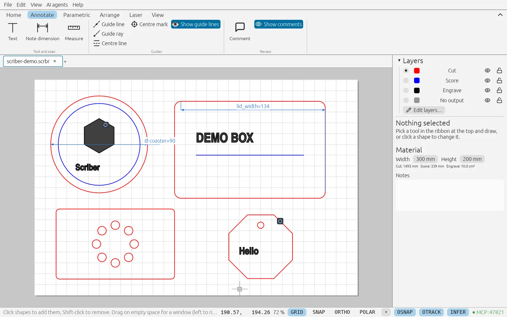

# Scriber

2D CAD for laser cutters, made for AI agents and the people who steer them.

Scriber is AI-first: its MCP server lets an AI agent (Claude Code, Codex, Cursor, …) draw, edit, check
and prepare designs for the laser, live in your Scriber window. You can step in at any time: pin a
review comment on the canvas, edit by hand, undo, or take over. The window and the agents work
through the same commands and share one undo history.

The controls follow AutoCAD and DraftSight (command line, dynamic input, constraints, grips,
OSNAP/POLAR), so users of those feel at home quickly.



## Features

- **MCP server for agents**: streamable HTTP on `127.0.0.1:47821` while the editor runs, plus a stdio
  bridge (`scriber mcp`) for agents that only speak stdio. One click (or `scriber agents add`) connects
  the agents it finds and installs the Scriber agent skill where the agent supports skills.
- **Precise 2D CAD**: lines, polylines, arcs, curves, rectangles, polygons, text; fillet, chamfer,
  offset, boolean, arrays, trim, extend, stretch; geometric and dimensional constraints with named
  parameters; snaps, polar tracking and grips.
- **Layers for the laser**: cut, score, engrave or no output, each with its own power, speed, passes
  and line density.
- **Machines and materials**: a library of laser settings per machine and module. Scriber ships
  machine definitions only, no material presets. Subscribe to libraries in GitHub repositories,
  exchange them as `.scrlib`/zip files, or import materials from the xTool Studio cache.
- **Import and export**: SVG, DXF, PNG and xTool Studio `.xs` export; `.xs`, DXF, SVG and image import.
- **Preview and check**: a laser preview and a pre-flight check that catches problems before you cut.
- **Review comments**: annotations on the canvas that agents read, answer and resolve.
- **Several documents** in tabs, and **themes**, including one that follows the
  [Omarchy](https://omarchy.org) desktop theme.

## Build and run

There are no release downloads yet. Build from source with [Rust](https://rustup.rs) (edition 2024).
Scriber runs on Linux and Windows.

```sh
git clone https://github.com/ExeQue/scriber.git
cd scriber
cargo build --release
./target/release/scriber              # the editor
./target/release/scriber box.scrbr    # open a project
./target/release/scriber mcp          # MCP on stdio (starts the editor if it is not running)
./target/release/scriber --help       # all commands
```

## Connecting an agent

In the editor, **AI agents → Connect AI agents…**, or from a terminal:

```sh
scriber agents add
```

Then restart the agent and ask it to draw something. See
[Connecting agents](docs/agents/connecting.md) and
[How agents work with Scriber](docs/agents/working-with-agents.md).

## Documentation

The user guide is a [VitePress](https://vitepress.dev) site in [`docs/`](docs/). To read it locally
(Node.js 18 or newer):

```sh
npm run docs:install                  # once
npm --prefix docs run docs:dev        # http://127.0.0.1:5191
```

Start with [Getting started](docs/guide/getting-started.md).

## Contributing

See [CONTRIBUTING.md](CONTRIBUTING.md). AI coding agents: see [AGENTS.md](AGENTS.md).

## Not affiliated with xTool

Scriber is an independent project. It is not affiliated with, endorsed by or sponsored by xTool.
xTool and xTool Studio are trademarks of their respective owners. Scriber's `.xs` support is based on
interoperability analysis of project files that users saved themselves; see the
[.xs format notes](docs/xs-format.md).

## License

[MIT](LICENSE), copyright (c) 2026 Morten Harders. The bundled [Lucide](https://lucide.dev) icon font
is under the ISC license ([`assets/fonts/LUCIDE-LICENSE`](assets/fonts/LUCIDE-LICENSE)).
